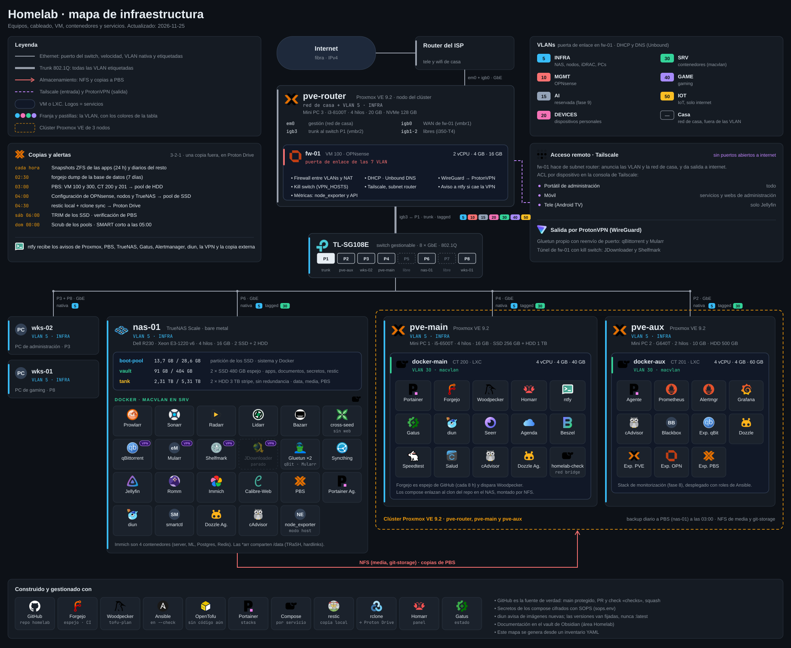

# Infraestructura Homelab

Homelab personal gestionado íntegramente como Infraestructura como Código. Dos objetivos en paralelo: un stack self-hosted privado que sustituye servicios cloud, y un pipeline DevOps de nivel productivo construido con las mismas herramientas que se usan en entornos enterprise.

**Versión:** 3.3 — Noviembre 2026
**Estado:** Fases 0–4, 4b, 7 y 8 completadas



*Mapa generado desde el inventario del homelab, sin IP, puertos ni rutas internas. [English version](docs/diagrama/homelab-en.png).*

---

## Tabla de Contenidos

1. [Historial de Fases](#1-historial-de-fases)
2. [Hardware](#2-hardware)
3. [Red e Infraestructura](#3-red-e-infraestructura)
4. [Servicios](#4-servicios)
5. [Virtualización](#5-virtualización)
6. [Almacenamiento](#6-almacenamiento)
7. [Acceso Remoto](#7-acceso-remoto)
8. [DevOps e IaC](#8-devops-e-iac)

---

## 1. Historial de Fases

### Phase 1 — Red (✅ Completada)

| Aspecto | Antes | Después |
|---|---|---|
| Topología de red | Teórica | Dual-switch implementado (router ISP + switch gestionado) |
| VLANs | Concepto | 7 VLANs operativas con políticas de salida por VLAN |
| DHCP | Genérico | Dnsmasq por VLAN con reservas estáticas |
| VPN remota | WireGuard (planificado) | Tailscale implementado — funciona con CGNAT, sin puertos abiertos |
| Reglas de firewall | Teóricas | Implementadas con aislamiento inter-VLAN y accesos selectivos |

### Phase 2 — Almacenamiento y Multimedia (✅ Completada)

| Aspecto | Resultado |
|---|---|
| NAS | TrueNAS Scale en Dell R230 |
| Almacenamiento | Pools ZFS: `tank` (stripe HDD) + `vault` (mirror SSD) |
| Stack multimedia | Sonarr, Radarr, Lidarr, Prowlarr, Bazarr, qBittorrent, Calibre-Web Automated, Shelfmark, Romm — todos operativos |
| Backup | Proxmox Backup Server (PBS) en Docker en el NAS |
| Sincronización | Syncthing para sync con dispositivos móviles |

### Phase 3 — Clúster y Gestión de Contenedores (✅ Completada)

| Aspecto | Antes | Después |
|---|---|---|
| Proxmox | Nodo único | **Clúster de 3 nodos: pve-router + pve-main + pve-aux** |
| docker-main | No existía | LXC Debian 13, VLAN 30, 4GB RAM |
| docker-aux | No existía | LXC Debian 13, VLAN 30, 9GB RAM |
| Red macvlan | Solo NAS | Los 3 hosts Docker con rangos no solapados |
| Portainer | No existía | Server en docker-main + Agents en aux y nas |
| Almacenamiento NFS clúster | Solo NAS | `tank/vms/images` montado en pve-main y pve-aux |

---

## 2. Hardware

### Nodos de producción (24/7)

| ID | Dispositivo | Especificaciones | Rol |
|---|---|---|---|
| HW-SRV-01 | Dell R230 | 16GB RAM, 2x 3TB HDD, 2x 480GB SSD | NAS / TrueNAS Scale |
| HW-SRV-02 | Mini PC (quad-NIC) | 20GB RAM | Proxmox router + OPNsense VM |
| HW-SRV-03 | Mini PC | 16GB RAM, 256GB SSD, 1TB HDD | Nodo Proxmox principal |
| HW-SRV-04 | Mini PC | 10GB RAM | Nodo Proxmox secundario |

Todos los nodos de producción funcionan 24/7. El consumo total en idle es inferior a 100W.

### Nodo a demanda (planificado)

| ID | Dispositivo | Especificaciones | Rol |
|---|---|---|---|
| HW-SRV-05 | PC de sobremesa | 32GB DDR4, i7-7700K, GTX 1070, 240GB SSD, 1TB HDD | Nodo Proxmox de laboratorio fuera del clúster |

No está encendido 24/7: se despierta por Wake-on-LAN cuando hay trabajo y se apaga solo por inactividad. Aloja lo pesado y puntual (laboratorios, CI, GPU); lo que debe estar siempre disponible sigue en los nodos de producción.

### Estaciones de trabajo

| ID | Dispositivo | Especificaciones | Rol |
|---|---|---|---|
| HW-WKS-01 | PC de sobremesa | 32GB DDR5, Ryzen 7 9700X | Estación de trabajo principal |
| HW-WKS-02 | PC de sobremesa | 32GB DDR4, i7-7700K | Secundaria / estación de desarrollo |

---

## 3. Red e Infraestructura

### 3.1 Topología dual-switch

#### Switch 1: Router ISP

- Sin VLANs, gestiona `XX.XX`
- Conecta: Internet ↔ gestión Proxmox + WAN OPNsense
- **Justificación:** Gestión Proxmox aquí = siempre accesible independientemente del estado de OPNsense

#### Switch 2: TP-Link TL-SG108E (gestionado)

- VLANs 802.1Q, gestiona `10.0.x.0/24`
- Conecta: OPNsense ↔ todo el hardware físico en VLAN 5
- **Justificación:** Hardware físico aquí = independiente de OPNsense

La topología completa, de internet a cada contenedor, está en el [mapa del principio](docs/diagrama/homelab-es.png).

### 3.2 Segmentación VLAN

| VLAN | Nombre | Subred | Salida | Propósito |
|---|---|---|---|---|
| 5 | INFRA | XX.XX | ISP directo | Hardware físico: Proxmox, TrueNAS, IPMI |
| 10 | MGMT | XX.XX | ISP directo | Gestión: OPNsense |
| 15 | AI | XX.XX | ISP directo | Agentes AI (OpenClaw) — firewall estricto |
| 20 | DEVICES | XX.XX | ProtonVPN | Dispositivos personales |
| 30 | SRV | XX.XX | ProtonVPN + kill switch | Stacks Docker, workloads K3s |
| 50 | IOT | XX.XX | ProtonVPN | IoT no confiable — solo internet |
| 99 | GUEST | XX.XX | ProtonVPN | Invitados — solo internet |

**Separación crítica: INFRA vs MGMT**

- **VLAN 5 (INFRA):** Capa física. Hardware en el switch gestionado. ✅ Funciona aunque OPNsense esté caído.
- **VLAN 10 (MGMT):** Capa virtualizada. Servicios en VMs. ❌ Cae si OPNsense falla. Pero ✅ INFRA permanece accesible.

### 3.3 Configuración de puertos del switch (TL-SG108E)

| VLAN | P1 | P2 | P3 | P4 | P6 | Descripción |
|---|---|---|---|---|---|---|
| 5 (INFRA) | T | U | U | U | U | Hardware físico |
| 10 (MGMT) | T | - | - | - | - | Servicios virtualizados |
| 15 (AI) | T | - | - | - | - | VLAN AI aislada |
| 30 (SRV) | T | - | - | - | **T** | Servicios — **P6 Tagged requerido para contenedores NAS** |
| 50 (IOT) | T | - | - | - | - | IoT aislado |

> **P6 VLAN 30 Tagged:** Necesario para que los contenedores Docker en el NAS con direcciones macvlan `srv-net` sean accesibles desde fuera del NAS. Sin esto, el tráfico VLAN 30 queda confinado dentro del NAS.

**Leyenda:** T=Tagged, U=Untagged, -=No miembro

| Puerto | Dispositivo | VLAN | Rol |
|---|---|---|---|
| P1 | pve-router igb3 | Trunk (todas las VLANs tagged) | Trunk router OPNsense |
| P2 | pve-aux | INFRA (5), untagged | Nodo Proxmox |
| P3 | wks-02 | INFRA (5), untagged | Estación de desarrollo |
| P4 | pve-main | INFRA (5), untagged | Nodo Proxmox |
| P6 | nas-01 | INFRA (5) untagged + SRV (30) tagged | NAS |
| P8 | wks-01 | INFRA (5), untagged | Estación de trabajo principal |

### 3.4 Rangos DHCP por VLAN (Dnsmasq en OPNsense)

| VLAN | Rango dinámico | Reservas estáticas |
|---|---|---|
| 5 (INFRA) | .100–.200 | nas-01, pve-main, pve-aux, wks-01, wks-02 |
| 10 (MGMT) | .100–.200 | OPNsense |
| 30 (SRV) | .100–.254 | `.10–.63` reservado para contenedores macvlan |
| 50 (IOT) | .100–.200 | — |

### 3.5 Rangos de direcciones macvlan (VLAN 30 — sin solapamiento)

| Host | Interfaz | Rango asignado |
|---|---|---|
| docker-nas (nas-01) | vlan30 | XX.XX |
| docker-main (LXC pve-main) | eth0 | XX.XX |
| docker-aux (LXC pve-aux) | eth0 | XX.XX |
| DHCP dinámico | — | XX.XX+ |

### 3.6 Reglas de firewall (OPNsense) — políticas clave

```
INFRA → puede alcanzar: INFRA, MGMT, SRV, internet
MGMT  → puede alcanzar: INFRA, SRV, internet
SRV   → puede alcanzar: SRV (intra), internet vía ProtonVPN (kill switch activo)
IOT   → puede alcanzar: solo internet (ProtonVPN)
AI    → puede alcanzar: internet (restringido), sin acceso a otras VLANs
```

---

## 4. Servicios

### Nomenclatura

```
Formato: [categoría]-[función]-[instancia]

Categorías:
  fw   = Firewall/Router      prx  = Proxy
  dns  = DNS                  auth = Autenticación
  mon  = Monitorización       nas  = Almacenamiento
  media = Multimedia          arr  = Gestión de contenidos
  dev  = Desarrollo           ai   = Inteligencia Artificial
  app  = Aplicaciones         bkp  = Backup
```

### 4.1 Infraestructura física (VLAN 5 — INFRA)

| ID | Servicio | Host | Tipo | Función |
|---|---|---|---|---|
| infra-pve-01 | Proxmox VE | pve-router | Bare Metal | Hipervisor + host OPNsense |
| infra-pve-02 | Proxmox VE | pve-main | Bare Metal | Hipervisor principal |
| infra-pve-03 | Proxmox VE | pve-aux | Bare Metal | Hipervisor secundario |
| nas-01 | TrueNAS Scale | nas-01 | Bare Metal | NAS — ZFS, NFS, Docker |
| infra-ipmi-01 | iDRAC/IPMI | nas-01 | Firmware | Gestión de hardware Dell |

### 4.2 Gestión (VLAN 10 — MGMT)

| ID | Servicio | Host | Tipo | Puerto | Función |
|---|---|---|---|---|---|
| fw-opnsense-01 | OPNsense | pve-router | VM | 443 | **Firewall, NAT, DHCP, VLANs, Tailscale** |

### 4.3 DNS

| ID | Servicio | Host | Función |
|---|---|---|---|
| dns-unbound-01 | Unbound (integrado en OPNsense) | fw-01 | Resolver recursivo + DNSSEC + split-horizon |

> **Decisión de diseño:** Unbound integrado en OPNsense en lugar de AdGuard Home. Justificación: sin servicios adicionales que mantener, soporte nativo de DNSSEC y split-horizon para el dominio `home.arpa`.

### 4.4 Monitorización (VLAN 30 — SRV)

En marcha en `docker-main` (y diun también en `docker-nas`):

| ID | Servicio | Host | Puerto | Estado | Función |
|---|---|---|---|---|---|
| mon-ntfy-01 | ntfy | docker-main | 80 | ✅ Operativo | Canal único de alertas (Proxmox, PBS, TrueNAS, scripts y servicios) |
| mon-gatus-01 | Gatus | docker-main | 8080 | ✅ Operativo | Disponibilidad de los servicios con avisos a ntfy |
| mon-diun-01 | diun | docker-main, docker-nas | — | ✅ Operativo | Avisa a ntfy de versiones nuevas de las imágenes en uso (no actualiza) |
| mon-homarr-01 | Homarr | docker-main | 7575 | ✅ Operativo | Dashboard del homelab |
| mon-check-01 | homelab-check | K3s (k3s-01) | — | ✅ Operativo | Imagen propia (build → Trivy → registro de Forgejo) que comprueba URLs y avisa a ntfy |
| mon-beszel-01 | Beszel (hub + agentes) | docker-main; agentes en cada nodo, el NAS y los LXC con Docker | 8090 | ✅ Operativo | Monitorización de hardware: CPU, RAM, carga, red, temperaturas, S.M.A.R.T. y uso por contenedor, con historial |
| mon-speedtest-01 | Speedtest Tracker | docker-main | 80 | ✅ Operativo | Tests programados de velocidad a Internet (cada 6 h); adelantado de la fase 8 |

Phase 8 — stack de métricas en `docker-aux`, desplegado con roles de Ansible (`infrastructure/ansible/`):

| ID | Servicio | Host | Puerto | Estado | Función |
|---|---|---|---|---|---|
| mon-prometheus-01 | Prometheus | docker-aux | 9090 | ✅ Operativo | Base de datos de métricas y reglas de alertas (retención de 30 días, configuración de scrape generada desde el inventario de Ansible) |
| mon-alertmanager-01 | Alertmanager | docker-aux | 9093 | ✅ Operativo | Reparte las alertas a ntfy con una prioridad por gravedad e inhibe el ruido de un host caído |
| mon-grafana-01 | Grafana | docker-aux | 3000 | ✅ Operativo | Ocho dashboards provisionados desde ficheros del repo: visión global, contenedores, salud de discos, sondas HTTP, torrents, Proxmox, red y K3s |
| mon-nodeexp-01 | Node Exporter | Nodos Proxmox, hosts Docker, K3s, NAS (contenedor) y el firewall (plugin de OPNsense) | 9100 | ✅ Operativo | Métricas de CPU, RAM, disco y red, más la potencia de CPU (RAPL) en los nodos Proxmox (binario fijado, unidad systemd endurecida) |
| mon-cadvisor-01 | cAdvisor | docker-main, docker-aux, NAS | 8080 | ✅ Operativo | Métricas por contenedor |
| mon-smartctl-01 | smartctl_exporter | Nodos Proxmox, NAS | 9633 | ✅ Operativo | Salud y temperatura S.M.A.R.T. en solo lectura, con 12 reglas de alerta; sustituye a Scrutiny |
| mon-blackbox-01 | Blackbox Exporter | docker-aux | 9115 | ✅ Operativo | Sondas HTTP de los mismos servicios que vigila Gatus (los objetivos se leen de su configuración, así que no hay direcciones en el repo): disponibilidad, latencia y caducidad de certificados en un dashboard; Gatus sigue dando los avisos de caída |
| mon-qbit-01 | Exporter de qBittorrent | docker-aux | 8090 | ✅ Operativo | Torrents, velocidades, ratio global y conectividad, leídos con una clave de API; subida y ratio por tracker de forma aproximada (etiquetas de tracker recortadas al dominio), con dashboard y alertas por no ser conectable, tener torrents en cola o un bucle de reinicios de la VPN (los reinicios de Gluetun se cuentan en sus logs) |
| mon-dozzle-01 | Dozzle (hub + agentes) | docker-aux; agentes en los demás hosts Docker | 8080 | ✅ Operativo | Logs de contenedores en vivo de todos los hosts Docker en una sola web, detrás de un login; no guarda nada (un historial de logs necesitaría Loki) |
| mon-pve-01 | Exporter de Proxmox | docker-aux | 9221 | ✅ Operativo | Clúster, quórum, nodos, VM, contenedores y almacenamiento leídos de la API de Proxmox con un token de solo lectura |
| mon-opnsense-01 | Exporter de OPNsense | docker-aux | 8080 | ✅ Operativo | Tráfico y errores por VLAN, pasarelas, tabla de estados y paquetes del firewall, WireGuard y servicios, leídos de la API de OPNsense con un usuario de solo lectura |
| mon-pbs-01 | Exporter de PBS | docker-aux | 10019 | ✅ Operativo | Antigüedad y número de copias por VM y contenedor, uso de los datastores y salud del host, leídos de la API de PBS con un token de solo lectura |
| mon-ksm-01 | kube-state-metrics | K3s (k3s-01) | — | ✅ Operativo | Estado de los objetos de Kubernetes (pods, deployments, nodos) para Prometheus; solo Prometheus puede llegar a él (NetworkPolicy) |

Todavía planificado, fuera de la fase 8:

| ID | Servicio | Host | Puerto | Función |
|---|---|---|---|---|
| mon-loki-01 | Loki | docker-aux | 3100 | Agregación centralizada de logs |
| mon-homepage-01 | Homepage | docker-aux | 3003 | Dashboard de inicio |
| mon-ipmi-01 | IPMI Exporter | docker-aux | 9290 | Métricas de hardware Dell |

### 4.5 Almacenamiento de usuario (VLAN 30 — SRV)

| ID | Servicio | Host | Tipo | Función |
|---|---|---|---|---|
| app-immich-01 | Immich | docker-nas | Docker macvlan | ✅ Gestión de fotos/vídeo (alternativa a Google Photos) |
| app-syncthing-01 | Syncthing | docker-nas | Docker macvlan | ✅ Sync P2P con dispositivos móviles |
| app-paperless-01 | Paperless-ngx | docker-main | Docker | Gestión documental con OCR |
| app-agenda-01 | Agenda | docker-main | Docker macvlan | ✅ API propia para crear citas en el calendario de iCloud (CalDAV) desde Obsidian y la terminal |
| app-salud-01 | Salud | docker-main | Docker macvlan | ✅ API propia que descarga a diario las métricas del Garmin (API personal de Garmin Connect) a SQLite para un panel de salud en Obsidian, con señales por reglas frente a la línea base propia y un informe mensual en PDF |

### 4.6 Multimedia (VLAN 30 — SRV)

> Jellyfin se desplegó en `docker-nas` en lugar de `docker-main`: acceso local al pool de media, sin salto NFS. Seerr (sucesor de Overseerr) se despliega en `docker-main`.

| ID | Servicio | Host | Tipo | Puerto | Estado | Función |
|---|---|---|---|---|---|---|
| media-jellyfin-01 | Jellyfin | docker-nas | Docker macvlan | 8096 | ✅ Operativo | Servidor de streaming multimedia (acceso local al pool de media) |
| media-seerr-01 | Seerr | docker-main | Docker macvlan | 5055 | ✅ Desplegado | Watchlist y peticiones multimedia |
| arr-sonarr-01 | Sonarr | docker-nas | Docker macvlan | 8989 | ✅ Operativo | Gestión automática de series |
| arr-radarr-01 | Radarr | docker-nas | Docker macvlan | 7878 | ✅ Operativo | Gestión automática de películas |
| arr-lidarr-01 | Lidarr | docker-nas | Docker macvlan | 8686 | ✅ Operativo | Gestión automática de música |
| arr-prowlarr-01 | Prowlarr | docker-nas | Docker macvlan | 9696 | ✅ Operativo | Gestor centralizado de indexers |
| arr-bazarr-01 | Bazarr | docker-nas | Docker macvlan | 6767 | ✅ Operativo | Descarga automática de subtítulos |
| media-qbittorrent-01 | qBittorrent | docker-nas | Docker macvlan | 8080 | ✅ Operativo | Cliente de descargas web (enrutado por ProtonVPN) |
| media-cwa-01 | Calibre-Web Automated | docker-nas | Docker macvlan | 8083 | ✅ Operativo | Biblioteca de ebooks con ingesta y conversión automática |
| media-jdownloader-01 | JDownloader 2 | docker-nas | Docker macvlan | 5800 | ⏸️ Bajo demanda | Gestor de descargas directas (parado; se arranca cuando hace falta) |
| media-mularr-01 | Mularr | docker-nas | Docker macvlan | 8940 | ✅ Operativo | aMule (eD2k) conectado a Sonarr y Radarr como cliente de descargas e indexer (detrás de su propio Gluetun) |
| media-crossseed-01 | cross-seed | docker-nas | Docker | — | ✅ Operativo | Busca los mismos torrents en otros trackers y los siembra desde los ficheros existentes |
| media-shelfmark-01 | Shelfmark | docker-nas | Docker macvlan | 8084 | ✅ Operativo | Búsqueda y descarga de ebooks hacia la carpeta de ingesta de Calibre-Web Automated |
| media-romm-01 | Romm | docker-nas | Docker macvlan | 8080 | ✅ Operativo | Biblioteca de ROMs con metadatos y juego en el navegador, sobre la carpeta de juegos del NAS |

### 4.7 DevOps (VLAN 30 — SRV)

| ID | Servicio | Host | Tipo | Puerto | Estado | Función |
|---|---|---|---|---|---|---|
| dev-portainer-01 | Portainer | docker-main | Docker macvlan | 9443 | ✅ Operativo | UI de gestión multi-host de contenedores |
| dev-forgejo-01 | Forgejo | docker-main | Docker macvlan | 3000 | ✅ Phase 4 | Servidor Git self-hosted |
| dev-woodpecker-01 | Woodpecker CI | docker-main | Docker macvlan | 8000 | ✅ Phase 4 | Pipelines CI/CD |
| dev-jenkins-01 | Jenkins | — | — | — | 🚫 Fuera del alcance | No cabe en el nodo de 4 GB; lo cubre Woodpecker |
| dev-argocd-01 | ArgoCD | K3s (k3s-01) | Helm | 443 | ✅ Phase 4b | Entrega continua GitOps |
| dev-sonarqube-01 | SonarQube | — | — | — | 🚫 Fuera del alcance | No cabe en el nodo de 4 GB |
| dev-vault-01 | HashiCorp Vault | K3s (k3s-01) | Helm | 8200 | ✅ Phase 4b | Secretos de las apps en Kubernetes |
| dev-awx-01 | AWX | — | — | — | 🚫 Fuera del alcance | Ansible se ejecuta desde la línea de comandos |

### 4.8 IA (VLAN 15 — AI)

| ID | Servicio | Host | Tipo | Puerto | Estado | Función |
|---|---|---|---|---|---|---|
| ai-openclaw-01 | OpenClaw | pve-router | LXC | 18789 | ⏳ Phase 9 | Agente IA para automatización del homelab |

### 4.9 Backup

| ID | Servicio | Host | Tipo | Puerto | Estado | Función |
|---|---|---|---|---|---|---|
| bkp-pbs-01 | Proxmox Backup Server | nas-01 | Docker | 8007 | ✅ Operativo | Backups de VMs/LXCs al NAS |

**Total: 35+ servicios en 3 hosts Docker + NAS + 3 nodos Proxmox + OPNsense**

---

## 5. Virtualización

### 5.1 Clúster Proxmox (3 nodos)

| Nodo | Hardware | RAM | Rol |
|---|---|---|---|
| pve-router | Mini PC (quad-NIC) | 20GB | Router + servicios de gestión |
| pve-main | Mini PC | 16GB | Cargas Docker principales, nodo K3s (k3s-01) |
| pve-aux | Mini PC | 10GB | Servicios auxiliares |

### 5.2 Distribución de cargas

**pve-router (20GB)**
- `fw-opnsense-01` (VM, 4GB) — Firewall OPNsense
- `ai-openclaw-01` (LXC, 4GB) — Agente IA *(Phase 9)*

**pve-main (16GB)**
- `docker-main` (LXC, 4GB) ✅ — Portainer, Forgejo, Woodpecker, Seerr, ntfy, Gatus, diun, Homarr, Agenda, Salud, Beszel, Speedtest Tracker
- `k3s-01` (VM, 4GB, apagable) ✅ — K3s de un nodo: ArgoCD, Vault, cert-manager, Trivy Operator, homelab-check

**pve-aux (10GB)**
- `docker-aux` (LXC, 6GB) ✅ — Monitorización, servicios cloud

### 5.3 Decisión VM vs LXC

| Tipo de carga | Uso | Motivo |
|---|---|---|
| OPNsense | VM | Necesita su propio kernel |
| Nodo K3s | VM | Requiere módulos de kernel (ip_tables, nf_conntrack, br_netfilter) que los LXCs restringen |
| Todo lo demás | LXC | Ahorra ~600MB RAM idle por instancia |

### 5.4 Configuración LXC para Docker

```ini
# /etc/pve/lxc/<CTID>.conf — requerido antes del primer arranque
lxc.apparmor.profile: unconfined
lxc.cgroup2.devices.allow: a
lxc.cap.drop:
features: keyctl=1
```

> **Advertencia:** NO añadir `nesting=1` junto con `apparmor: unconfined` — entran en conflicto y el LXC fallará al arrancar.

---

## 6. Almacenamiento

### 6.1 Pools ZFS

| Pool | Discos | Capacidad | Layout | Propósito |
|---|---|---|---|---|
| `tank` | 2x HDD 3TB | ~6TB | Stripe | Datos de alto volumen y reemplazables |
| `vault` | 2x SSD 480GB | ~400GB útiles | Mirror RAID-1 | Datos críticos: rápido y redundante |

### 6.2 Estructura de datasets

```
tank  (~6TB — stripe HDD)
├── backups/
│   ├── proxmox/      ← Datastore PBS
│   ├── databases/
│   └── configs/
├── data/             ← Un solo dataset para descargas y biblioteca (hardlinks, guía TRaSH)
│   ├── torrents/  movies/ tv/ music/
│   ├── emule/ jdownloader/
│   └── media/     movies/ tv/ music/
├── media/            ← Lo que no gestionan las *arr: fotos, libros, juegos
└── vms/
    └── images/       ← Almacenamiento NFS clúster Proxmox

vault  (~400GB — mirror SSD)
├── apps/             ← Appdata de contenedores (NFS → hosts Docker)
├── docker/           ← Docker daemon data-root (NFS → hosts Docker)
├── documents/        ← Documentos personales (NFS + SMB)
├── git-storage/      ← Repositorios Forgejo
└── secrets/          ← Claves Age, claves SSH, certificados
```

### 6.3 Shares NFS

| Share | Ruta | Acceso | Notas |
|---|---|---|---|
| data/media | /tank/data/media | VLAN 30, INFRA | Películas, series y música (Jellyfin, \*arr) |
| media | /tank/media | VLAN 30, INFRA | Fotos, libros y juegos |
| backups | /tank/backups | Solo VLAN 5 | Solo PBS y Restic |
| vms | /tank/vms | VLAN 5 | Almacenamiento compartido clúster Proxmox |
| vault/apps | /vault/apps | VLAN 30 | Appdata Docker (SSD) |
| vault/docker | /vault/docker | VLAN 30 | Docker data-root (SSD) |
| vault/git-storage | /vault/git-storage | VLAN 30, INFRA | Repos Forgejo |

---

## 7. Acceso Remoto

**Tailscale** funciona como subnet router plugin dentro de OPNsense, anunciando el rango completo `XX.XX`. Esto proporciona acceso a todas las VLANs y servicios desde cualquier dispositivo con cliente Tailscale.

**Por qué Tailscale y no WireGuard tradicional:** El ISP usa CGNAT sin IPv4 pública. WireGuard tradicional requiere un endpoint público para recibir conexiones, lo que es imposible bajo CGNAT. Tailscale usa su servidor de coordinación para establecer túneles peer-to-peer mediante NAT traversal — sin necesidad de abrir puertos en el router ISP.

Clientes Tailscale: estación de trabajo principal, dispositivos móviles.

---

## 8. DevOps e IaC

### 8.1 Filosofía y Decisiones de Arquitectura

El stack DevOps replica un entorno enterprise real usando exclusivamente herramientas open-source y gratuitas. Cada herramienta tiene un equivalente corporativo directo, permitiendo demostrar experiencia práctica sin haber trabajado en una empresa DevOps.

| Decisión | Elección | Motivo |
|---|---|---|
| Git privado (IaC, configs) | **Forgejo** | Ligero, self-hosted, <200MB RAM |
| Git público (proyectos, CV) | **GitHub / GitLab.com** | Visibilidad, Actions/CI gratuito |
| CI/CD infraestructura | **Woodpecker CI** | Webhooks nativos con Forgejo, YAML idéntico a GitHub Actions |
| Registry de contenedores | **Registro de Forgejo** | Incluido en Forgejo (OCI): ningún servicio más que mantener; las imágenes se escanean en el pipeline antes de subirlas |
| Orquestación (stack DevOps) | **K3s, un nodo** | Mismo API que EKS/AKS/GKE, ~512MB idle; un nodo de 4 GB apagable, creado con OpenTofu |
| Orquestación (servicios personales) | **Docker Compose** | Los servicios estables no necesitan scheduling ni rolling updates de K8s |
| GitOps | **ArgoCD** | Pull-based, declarativo; `main` despliega en dev y una etiqueta semver promociona a prod |
| IaC provisioning | **OpenTofu** | Fork open-source de Terraform, 100% compatible HCL, licencia MPL-2.0 |
| IaC configuración | **Ansible** | Estándar de la industria, igual en homelab que en empresas |
| Gestor de paquetes K8s | **Helm** | Estándar para desplegar aplicaciones en Kubernetes |
| Secretos de los servicios | **Fuera de Git** | Los `.env` reales solo viven en los hosts, cubiertos por snapshots ZFS y PBS (copia externa en preparación); SOPS + Age está preparado para lo que haya que versionar |
| Secretos en K8s | **HashiCorp Vault** | Secretos dinámicos, auto-rotación, estándar enterprise |
| Escaneo de vulnerabilidades | **Trivy** | Paso del pipeline en Woodpecker (falla con CVE críticos antes de publicar) y Trivy Operator en el clúster |
| CNI Kubernetes | **Flannel de K3s** | Con el controlador de NetworkPolicies de K3s: aplica las políticas sin un segundo CNI |
| Estrategia de branches | **Trunk-based** | Main protegido, feature branches de vida corta, PR obligatorio |

> **Por qué dos capas de orquestación:** Los servicios personales (Jellyfin, \*arr, Immich) son estables y no se benefician del scheduling, auto-healing ni rolling updates de K8s. Docker Compose es más sencillo de operar y depurar. K3s se reserva para el stack DevOps donde sí aporta valor real: despliegues declarativos, GitOps y operaciones Kubernetes demostrables.

### 8.2 Arquitectura por capas

```
┌────────────────────────────────────────────────────────────────┐
│                  CAPA GIT (Source of Truth)                    │
│                                                                │
│   Forgejo (privado)                GitHub / GitLab.com (público)│
│   ├── IaC (OpenTofu, Ansible)      ├── Proyectos personales     │
│   ├── Stacks Docker Compose        └── GitHub Actions / GL CI  │
│   ├── Manifiestos K8s + Helm values                            │
│   └── Secretos cifrados (SOPS+Age)                             │
└────────────────────────┬───────────────────────────────────────┘
                         │ Webhooks
                         ▼
┌──────────────────────────────────────┐
│  CI/CD (Woodpecker CI)               │
│  ├── lint, tofu plan                 │
│  └── imágenes propias: build → Trivy │
│       → publicación en registro      │
└──────────────────┬───────────────────┘
                   │ etiqueta de imagen en Git
                   ▼
┌──────────────────────────────────────┐      ┌─────────────────────────┐
│  GITOPS (ArgoCD en K3s)              │      │  SECRETOS               │
│  ├── App of Apps, auto-sync          │      │  SOPS+Age (Git)         │
│  ├── main       → namespace dev      │      │  Vault (runtime K8s)    │
│  └── tag semver → namespace prod     │      └────────────┬────────────┘
└──────────────────┬───────────────────┘                   │
                   ▼                                       │
┌──────────────────────────────────────┐                   │
│  K3S (k3s-01, un nodo)               │◄──────────────────┘
│  ├── ArgoCD, cert-manager, Vault     │
│  ├── Trivy Operator                  │
│  └── dev / prod (homelab-check)      │
└──────────────────────────────────────┘

IaC: OpenTofu (Proxmox, VM k3s-01) + Ansible (nodos, instalación de K3s)
Servicios personales: Docker Compose en los hosts Docker, fuera de K3s
```

### 8.3 Pipelines CI/CD

#### Pipeline de infraestructura (Woodpecker CI)

Cada push a Forgejo ejecuta:

```
push a Forgejo
        │
        ▼
Woodpecker CI
    ├── lint        yamllint + docker compose config + ansible-lint
    ├── validate    validación de esquema
    └── plan        OpenTofu fmt + validate + plan (PRs con cambios en infrastructure/)
```

> Los servicios de Docker Compose se despliegan uno a uno (`docker compose -p <servicio> up -d`), no desde CI: el despliegue continuo queda para ArgoCD en K3s. Un agente de CI con SSH a los hosts sería un riesgo mayor que la comodidad que aporta.

#### Pipeline de aplicaciones (Woodpecker + ArgoCD)

```
push a Forgejo (fuentes de imagen)
        │
        ▼
Woodpecker CI
    ├── build       kaniko
    ├── scan        Trivy — falla con CVE CRITICAL
    └── publish     skopeo → registro de Forgejo
                          │ etiqueta de imagen en el overlay de dev (a mano por ahora)
                          ▼
                     ArgoCD (K3s)
                          │ detecta el diff en Git
                          ▼
              main → dev   ·   tag semver → prod
```

> Jenkins y SonarQube formaban parte del plan original. No caben en un nodo de 4 GB y el alcance se recortó (2026-11-15); Woodpecker cubre build y scan, y ArgoCD el despliegue.

### 8.4 Arquitectura del Clúster K3s

K3s corre en una sola VM de Proxmox (no en un LXC — K3s requiere acceso a módulos de kernel que los LXCs restringen por defecto). La VM se crea con OpenTofu, se puede apagar y cabe en 4 GB de RAM; el plan original de varios nodos no cabía en la memoria disponible.

```
┌──────────────────────────────────────────────────────────┐
│                 K3s (k3s-01, un nodo)                     │
│                 VM en pve-main · VLAN 30 (SRV)            │
│                                                          │
│  • control plane + etcd (embebido, snapshots diarios)    │
│  • ArgoCD (App of Apps)    • HashiCorp Vault              │
│  • cert-manager (CA interna)                             │
│  • Trivy Operator          • homelab-check (dev, prod)   │
│                                                          │
│  CNI:       Flannel + controlador de NetworkPolicies K3s │
│  Ingress:   Traefik (por defecto en K3s)                 │
│  Storage:   local-path + NFS (csi-driver-nfs → NAS)      │
│  TLS:       cert-manager                                 │
└──────────────────────────────────────────────────────────┘
```

**Estrategia de namespaces:**

```
argocd/        ← ArgoCD
cert-manager/  ← cert-manager
vault/         ← HashiCorp Vault
trivy-system/  ← Trivy Operator (escanea dev y prod)
dev/           ← entorno de desarrollo (sigue main)
prod/          ← entorno de producción (sigue la etiqueta semver más alta)
```

Todos los namespaces llevan NetworkPolicy; `dev` y `prod` además tienen ResourceQuota y secretos propios en Vault, y no se ven entre sí.

**Por qué Flannel con el controlador de K3s (y no Calico):** K3s incluye un controlador de NetworkPolicies junto a Flannel, así que las políticas se aplican sin un segundo CNI. En un solo nodo de 4 GB Calico añade memoria y piezas sin aportar más aprendizaje. La API de NetworkPolicy es agnóstica al CNI, así que lo aprendido sirve directamente en EKS/AKS.

**Fuera del alcance:** Jenkins, SonarQube, AWX y PostgreSQL (no caben en 4 GB) y Calico. Las métricas esperan a la fase de monitorización y Velero a un almacén S3.

### 8.5 Estructura del Repositorio

```
.
├── infrastructure/
│   ├── opentofu/
│   │   └── proxmox/        ← Definiciones de LXCs y VMs (incluida k3s-01)
│   ├── ansible/
│   │   ├── inventory/
│   │   ├── group_vars/
│   │   ├── playbooks/
│   │   └── roles/
│   └── helm/               ← Helm values del stack K3s
│       ├── argocd/
│       ├── cert-manager/
│       ├── trivy-operator/
│       └── vault/
├── services/
│   ├── docker-compose/     ← Servicios personales (stacks Compose)
│   │   ├── media/
│   │   ├── core/
│   │   ├── monitoring/
│   │   ├── cloud/
│   │   ├── storage/
│   │   └── devops/
│   └── k8s/                ← Workloads K3s
│       ├── argocd/apps/    ← App of Apps pattern
│       ├── platform/       ← ArgoCD, cert-manager, Vault, Trivy (+ NetworkPolicies)
│       ├── envs/           ← dev y prod (cuota, NetworkPolicy)
│       └── apps/           ← homelab-check (base Kustomize + overlays)
└── .woodpecker/            ← Definiciones de pipelines CI/CD
    ├── imagen-homelab-check.yml
    └── tofu-plan.yml
```

### 8.6 Gestión de Secretos

Todos los secretos siguen un modelo por capas:

| Capa | Herramienta | Cuándo |
|---|---|---|
| Docker Compose | **`.env` solo en el host** | Los valores reales nunca entran en Git (el repo es público); solo se suben las plantillas `.env.example`. Se respaldan con los datos del host |
| Git (si no hay alternativa) | **SOPS + Age** | Lo que haya que versionar se cifra antes del commit (`.sops.yaml`) |
| K8s / Pods K3s | **HashiCorp Vault** | Secretos dinámicos en runtime — inyectados por Vault Agent |
| Pipelines | **Secretos Woodpecker** | Credenciales de pipelines CI/CD |

Cada servicio puede guardar su `.env` real en Git como `sops.env`, junto a su `docker-compose.yml`: solo se cifran los valores (age) y los nombres de las variables quedan legibles. La clave privada age no sale de la máquina de administración, así que los hosts reciben el fichero descifrado por SSH y nunca tienen la clave. Script: `infrastructure/scripts/sops-env/sops-env.sh`.

```bash
# Cifrar en el repo el .env que usa un host
infrastructure/scripts/sops-env/sops-env.sh pull <servicio> <host> <ruta del .env>

# Qué variables difieren entre el repo y el host (solo nombres, nunca valores)
infrastructure/scripts/sops-env/sops-env.sh diff <servicio> <host> <ruta del .env>

# Escribir en el host el .env descifrado (con copia fechada)
infrastructure/scripts/sops-env/sops-env.sh push <servicio> <host> <ruta del .env>

# Editar en el sitio
sops services/docker-compose/<categoria>/<servicio>/sops.env

# Verificar siempre antes de commitear
git diff --staged | grep -iE "(password|key|token|secret)"
```

La CI (`sops-check`) falla si se sube algún `sops.env` sin cifrar.

**Reglas:**
- Nunca commitear archivos `.env` con valores reales
- Nunca commitear claves SSH, claves Age, tokens o contraseñas en texto plano
- `.env.example` con nombres de variables (sin valores) se commitea en su lugar
- Sin secretos estáticos en manifiestos K8s — Vault Agent los inyecta al arrancar el pod

### 8.7 Roadmap

| Fase | Descripción | Estado |
|---|---|---|
| **Phase 0** | Workstation, tooling, init del repo, SOPS + Age | ✅ Completada |
| **Phase 1** | Red: OPNsense, 7 VLANs, switch gestionado, Tailscale | ✅ Completada |
| **Phase 1.5** | VPN: Tailscale (remoto) + ProtonVPN WireGuard (salida) | ✅ Completada |
| **Phase 2** | TrueNAS, pools ZFS, stack \*arr, qBittorrent, Calibre-Web Automated, PBS, Syncthing — copia externa a Proton Drive, pool `tank` en mirror y datasets cifrados | ✅ Completada |
| **Phase 3** | Clúster Proxmox 3 nodos, LXCs Docker, Portainer multi-host | ✅ Completada |
| **Phase 4** | DevOps Core: Forgejo (espejo de GitHub), Woodpecker CI, imágenes propias escaneadas con Trivy y publicadas en el registro de Forgejo; todos los recursos de Proxmox (VM del firewall, LXC de Docker, VM de K3s) en OpenTofu, con el estado cifrado y un `tofu plan` de solo lectura en cada PR; runbook de recuperación escrito. Siguiente: un simulacro de recuperación cronometrado | ✅ Completada |
| **Phase 4b** | K3s de un nodo con ArgoCD, Vault, cert-manager, NetworkPolicies, entornos dev/prod y Trivy Operator; copia diaria de los snapshots de etcd al NAS; métricas del clúster (kube-state-metrics, API server y uso de contenedores) leídas por el Prometheus de la fase 8, con dashboard y alertas. La VM es un laboratorio y un temporizador la apaga cada noche. Pendiente: Velero (necesita un almacén S3); Jenkins, SonarQube y AWX, fuera del alcance. Planificado: nodo Proxmox a demanda (Wake-on-LAN y apagado por inactividad) para un K3s de varios nodos, laboratorios de virtualización y ciberseguridad en una VLAN aislada, un agente de CI y la GPU para IA local | ✅ Completada |
| **Phase 5** | Red y seguridad (replanteada): endurecer reglas de firewall, dominio interno, revisión de VLANs, convenciones de nombres | ⏳ Planificada |
| **Phase 6** | Apps personales: Immich (✅ adelantado), inventario del hogar; Paperless-ngx en evaluación | ⏳ Planificada |
| **Phase 7** | Multimedia: Jellyfin y Seerr (✅ adelantado); biblioteca de juegos (Romm ✅ desplegado) | ✅ Completada |
| **Phase 8** | Observabilidad y operación: Prometheus, Alertmanager, Grafana (8 dashboards, con los de Proxmox, red/OPNsense y K3s), exporters de nodos, contenedores, S.M.A.R.T., sondas HTTP y qBittorrent, un visor de logs en vivo (Dozzle) y exporters del clúster Proxmox, el firewall y PBS, desplegados con roles de Ansible, más las métricas y alertas del clúster K3s y la potencia de CPU (RAPL) en los nodos Proxmox. Se descartó medir el consumo con enchufes. A continuación, fuera de esta fase: planificador de tareas; Loki en evaluación | ✅ Completada |
| **Phase 9** | Agente IA acotado y siempre encendido, con mínimo privilegio (replanteada) | ⏳ Planificada |
| **Postimplantación** | Práctica de data engineering con datos reales del homelab: lakehouse, streaming CDC | ⏳ Ideas |

> Replanteado en octubre de 2026: el alcance original de la fase 5 (proxy inverso, SSO, gestor de contraseñas) y los elementos de Nextcloud y Uptime Kuma se descartaron tras revisarlos (un solo usuario, alternativas más ligeras ya en marcha).
