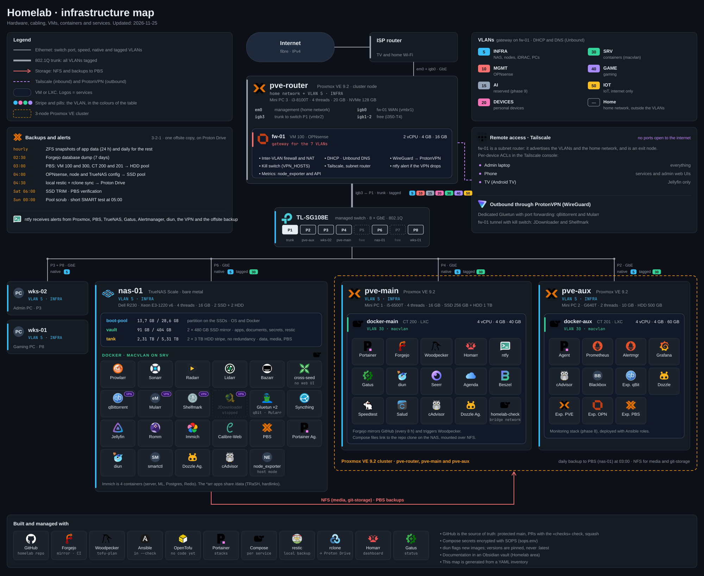

# Homelab Infrastructure

Personal homelab managed entirely as Infrastructure as Code. Two parallel objectives: a private self-hosted stack that replaces cloud services, and a production-grade DevOps pipeline built with the same tools used in enterprise environments.

**Version:** 3.3 — November 2026
**Status:** Phases 0–4 and 7 completed



*Map generated from the homelab inventory, without IPs, ports or internal paths. [Versión en español](docs/diagrama/homelab-es.png).*

---

## Table of Contents

1. [Phase History](#1-phase-history)
2. [Hardware](#2-hardware)
3. [Network & Infrastructure](#3-network--infrastructure)
4. [Services](#4-services)
5. [Virtualization](#5-virtualization)
6. [Storage](#6-storage)
7. [Remote Access](#7-remote-access)
8. [DevOps & IaC](#8-devops--iac)

---

## 1. Phase History

### Phase 1 — Network (✅ Done)

| Aspect | Before | After |
|---|---|---|
| Network topology | Theoretical | Dual-switch implemented (ISP router + managed switch) |
| VLANs | Concept | 7 VLANs operational with per-VLAN egress policies |
| DHCP | Generic | Dnsmasq per-VLAN with static reservations |
| Remote VPN | WireGuard (planned) | Tailscale implemented — works with CGNAT, no open ports required |
| Firewall rules | Theoretical | Implemented with inter-VLAN isolation and selective access |

### Phase 2 — Storage & Media (✅ Done)

| Aspect | After |
|---|---|
| NAS | TrueNAS Scale on Dell R230 |
| Storage | ZFS pools: `tank` (HDD stripe) + `vault` (SSD mirror) |
| Media stack | Sonarr, Radarr, Lidarr, Prowlarr, Bazarr, qBittorrent, Calibre-Web Automated, Shelfmark, Romm — all operational |
| Backup | Proxmox Backup Server (PBS) in Docker on NAS |
| Sync | Syncthing for mobile device sync |

### Phase 3 — Cluster & Container Management (✅ Done)

| Aspect | Before | After |
|---|---|---|
| Proxmox | Single node | **3-node cluster: pve-router + pve-main + pve-aux** |
| docker-main | Did not exist | LXC Debian 13, VLAN 30, 4GB RAM |
| docker-aux | Did not exist | LXC Debian 13, VLAN 30, 9GB RAM |
| Macvlan networking | NAS only | All 3 Docker hosts with non-overlapping ranges |
| Portainer | Did not exist | Server on docker-main + Agents on aux and nas |
| NFS cluster storage | NAS only | `tank/vms/images` mounted on pve-main and pve-aux |

---

## 2. Hardware

### Production nodes (24/7)

| ID | Device | Specs | Role |
|---|---|---|---|
| HW-SRV-01 | Dell R230 | 16GB RAM, 2x 3TB HDD, 2x 480GB SSD | NAS / TrueNAS Scale |
| HW-SRV-02 | Mini PC (quad-NIC) | 20GB RAM | Proxmox router + OPNsense VM |
| HW-SRV-03 | Mini PC | 16GB RAM, 256GB SSD, 1TB HDD | Proxmox primary node |
| HW-SRV-04 | Mini PC | 10GB RAM | Proxmox secondary node |

All production nodes run 24/7. Total idle power draw is under 100W.

### On-demand node (planned)

| ID | Device | Specs | Role |
|---|---|---|---|
| HW-SRV-05 | Desktop PC | 32GB DDR4, i7-7700K, GTX 1070, 240GB SSD, 1TB HDD | Standalone Proxmox lab node, outside the cluster |

It does not run 24/7: it wakes via Wake-on-LAN when there is work and powers itself off when idle. It hosts heavy, occasional workloads (labs, CI, GPU); anything that must always be available stays on the production nodes.

### Workstations

| ID | Device | Specs | Role |
|---|---|---|---|
| HW-WKS-01 | Desktop PC | 32GB DDR5, Ryzen 7 9700X | Primary workstation |
| HW-WKS-02 | Desktop PC | 32GB DDR4, i7-7700K | Secondary / dev workstation |

---

## 3. Network & Infrastructure

### 3.1 Dual-switch topology

#### Switch 1: ISP Router

- No VLANs, manages `XX.XX`
- Connects: Internet ↔ Proxmox management + OPNsense WAN
- **Rationale:** Proxmox management here = always reachable regardless of OPNsense state

#### Switch 2: TP-Link TL-SG108E (managed)

- 802.1Q VLANs, manages `10.0.x.0/24`
- Connects: OPNsense ↔ all physical hardware on VLAN 5
- **Rationale:** Physical hardware here = independent of OPNsense

The full topology, from the internet to every container, is in the [map at the top](docs/diagrama/homelab-en.png).

### 3.2 VLAN segmentation

| VLAN | Name | Subnet | Egress | Purpose |
|---|---|---|---|---|
| 5 | INFRA | XX.XX | Direct ISP | Physical hardware: Proxmox, TrueNAS, IPMI |
| 10 | MGMT | XX.XX | Direct ISP | Management: OPNsense |
| 15 | AI | XX.XX | Direct ISP | AI agents (OpenClaw) — strict firewall |
| 20 | DEVICES | XX.XX | ProtonVPN | Personal devices |
| 30 | SRV | XX.XX | ProtonVPN + kill switch | Docker stacks, K3s workloads |
| 50 | IOT | XX.XX | ProtonVPN | Untrusted IoT — internet only |
| 99 | GUEST | XX.XX | ProtonVPN | Guests — internet only |

**Critical separation: INFRA vs MGMT**

- **VLAN 5 (INFRA):** Physical layer. Hardware on managed switch. ✅ Works even if OPNsense is down.
- **VLAN 10 (MGMT):** Virtualized layer. Services in VMs. ❌ Falls if OPNsense fails. But ✅ INFRA remains accessible.

### 3.3 Switch port configuration (TL-SG108E)

| VLAN | P1 | P2 | P3 | P4 | P6 | Description |
|---|---|---|---|---|---|---|
| 5 (INFRA) | T | U | U | U | U | Physical hardware |
| 10 (MGMT) | T | - | - | - | - | Virtualized services |
| 15 (AI) | T | - | - | - | - | AI VLAN isolated |
| 30 (SRV) | T | - | - | - | **T** | Services — **P6 Tagged required for NAS containers** |
| 50 (IOT) | T | - | - | - | - | IoT isolated |

> **P6 VLAN 30 Tagged:** Required so Docker containers on the NAS with macvlan `srv-net` addresses are reachable from outside the NAS. Without this, VLAN 30 traffic stays confined to the NAS.

**Legend:** T=Tagged, U=Untagged, -=Not Member

| Port | Device | VLAN | Role |
|---|---|---|---|
| P1 | pve-router igb3 | Trunk (all VLANs tagged) | OPNsense router trunk |
| P2 | pve-aux | INFRA (5), untagged | Proxmox node |
| P3 | wks-02 | INFRA (5), untagged | Dev workstation |
| P4 | pve-main | INFRA (5), untagged | Proxmox node |
| P6 | nas-01 | INFRA (5) untagged + SRV (30) tagged | NAS |
| P8 | wks-01 | INFRA (5), untagged | Primary workstation |

### 3.4 DHCP ranges per VLAN (Dnsmasq on OPNsense)

| VLAN | Dynamic range | Static reservations |
|---|---|---|
| 5 (INFRA) | .100–.200 | nas-01, pve-main, pve-aux, wks-01, wks-02 |
| 10 (MGMT) | .100–.200 | OPNsense |
| 30 (SRV) | .100–.254 | `.10–.63` reserved for macvlan containers |
| 50 (IOT) | .100–.200 | — |

### 3.5 Macvlan address ranges (VLAN 30 — no overlap)

| Host | Interface | Assigned range |
|---|---|---|
| docker-nas (nas-01) | vlan30 | XX.XX |
| docker-main (LXC pve-main) | eth0 | XX.XX |
| docker-aux (LXC pve-aux) | eth0 | XX.XX |
| DHCP dynamic | — | XX.XX+ |

### 3.6 Firewall rules (OPNsense) — key policies

```
INFRA → can reach: INFRA, MGMT, SRV, internet
MGMT  → can reach: INFRA, SRV, internet
SRV   → can reach: SRV (intra), internet via ProtonVPN (kill switch active)
IOT   → can reach: internet only (ProtonVPN)
AI    → can reach: internet (restricted), no access to other VLANs
```

---

## 4. Services

### Nomenclature

```
Format: [category]-[function]-[instance]

Categories:
  fw   = Firewall/Router      prx  = Proxy
  dns  = DNS                  auth = Authentication
  mon  = Monitoring           nas  = Storage
  media = Multimedia          arr  = Content management
  dev  = Development          ai   = Artificial Intelligence
  app  = Applications         bkp  = Backup
```

### 4.1 Physical Infrastructure (VLAN 5 — INFRA)

| ID | Service | Host | Type | Function |
|---|---|---|---|---|
| infra-pve-01 | Proxmox VE | pve-router | Bare Metal | Hypervisor + OPNsense host |
| infra-pve-02 | Proxmox VE | pve-main | Bare Metal | Primary hypervisor |
| infra-pve-03 | Proxmox VE | pve-aux | Bare Metal | Secondary hypervisor |
| nas-01 | TrueNAS Scale | nas-01 | Bare Metal | NAS — ZFS, NFS, Docker |
| infra-ipmi-01 | iDRAC/IPMI | nas-01 | Firmware | Dell hardware management |

### 4.2 Management (VLAN 10 — MGMT)

| ID | Service | Host | Type | Port | Function |
|---|---|---|---|---|---|
| fw-opnsense-01 | OPNsense | pve-router | VM | 443 | **Firewall, NAT, DHCP, VLANs, Tailscale** |

### 4.3 DNS

| ID | Service | Host | Function |
|---|---|---|---|
| dns-unbound-01 | Unbound (OPNsense integrated) | fw-01 | Recursive resolver + DNSSEC + split-horizon |

> **Design decision:** Unbound integrated in OPNsense instead of AdGuard Home. Rationale: no additional services to maintain, native DNSSEC and split-horizon support for `.homelab` domain.

### 4.4 Monitoring (VLAN 30 — SRV)

Running on `docker-main` (diun also on `docker-nas`):

| ID | Service | Host | Port | Status | Function |
|---|---|---|---|---|---|
| mon-ntfy-01 | ntfy | docker-main | 80 | ✅ Operational | Single alert channel (Proxmox, PBS, TrueNAS, scripts and services) |
| mon-gatus-01 | Gatus | docker-main | 8080 | ✅ Operational | Service availability checks with ntfy alerts |
| mon-diun-01 | diun | docker-main, docker-nas | — | ✅ Operational | Notifies ntfy of new versions of the images in use (no auto-update) |
| mon-homarr-01 | Homarr | docker-main | 7575 | ✅ Operational | Homelab dashboard |
| mon-check-01 | homelab-check | K3s (k3s-01) | — | ✅ Operational | Custom image (build → Trivy → Forgejo registry) that checks URLs and alerts ntfy |
| mon-beszel-01 | Beszel (hub + agents) | docker-main; agents on every node, the NAS and the Docker LXCs | 8090 | ✅ Operational | Hardware monitoring: CPU, RAM, load, network, temperatures, S.M.A.R.T. and per-container usage, with history |
| mon-speedtest-01 | Speedtest Tracker | docker-main | 80 | ✅ Operational | Scheduled Internet speed tests (every 6 h); moved forward from Phase 8 |

Phase 8 — metrics stack on `docker-aux`, deployed with Ansible roles (`infrastructure/ansible/`):

| ID | Service | Host | Port | Status | Function |
|---|---|---|---|---|---|
| mon-prometheus-01 | Prometheus | docker-aux | 9090 | ✅ Operational | Metrics database and alert rules (30-day retention, scrape config generated from the Ansible inventory) |
| mon-alertmanager-01 | Alertmanager | docker-aux | 9093 | ✅ Operational | Routes alerts to ntfy with a priority per severity and inhibits the noise of a down host |
| mon-grafana-01 | Grafana | docker-aux | 3000 | ✅ Operational | Dashboards provisioned from files in the repo: global overview, containers, disk health |
| mon-nodeexp-01 | Node Exporter | Proxmox nodes, Docker hosts, K3s, NAS (container) and the firewall (OPNsense plugin) | 9100 | ✅ Operational | CPU, RAM, disk and network metrics, plus CPU power (RAPL) on the Proxmox nodes (pinned binary, hardened systemd unit) |
| mon-cadvisor-01 | cAdvisor | docker-main, docker-aux, NAS | 8080 | ✅ Operational | Per-container metrics |
| mon-smartctl-01 | smartctl_exporter | Proxmox nodes, NAS | 9633 | ✅ Operational | Read-only S.M.A.R.T. health and temperature, with 12 alert rules; replaces Scrutiny |
| mon-blackbox-01 | Blackbox Exporter | docker-aux | 9115 | ✅ Operational | HTTP probes of the same services Gatus watches (targets read from its config, so no addresses in the repo): availability, latency and certificate expiry in a dashboard; Gatus keeps the down alerts |
| mon-qbit-01 | qBittorrent exporter | docker-aux | 8090 | ✅ Operational | Torrents, speeds, global ratio and connectability, read with an API key; per-tracker upload and ratio as an approximation (tracker labels cut to the domain), with a dashboard and alerts for not being connectable or having queued torrents |
| mon-dozzle-01 | Dozzle (hub + agents) | docker-aux; agents on the other Docker hosts | 8080 | ✅ Operational | Live container logs from every Docker host in one web UI, behind a login; nothing is stored (log history would need Loki) |
| mon-pve-01 | Proxmox exporter | docker-aux | 9221 | ✅ Operational | Cluster, quorum, nodes, VMs, containers and storage read from the Proxmox API with a read-only token |
| mon-opnsense-01 | OPNsense exporter | docker-aux | 8080 | ✅ Operational | Per-VLAN traffic and errors, gateways, firewall state table and packets, WireGuard and services, read from the OPNsense API with a read-only user |

Still planned in Phase 8:

| ID | Service | Host | Port | Function |
|---|---|---|---|---|
| mon-loki-01 | Loki | docker-aux | 3100 | Centralized log aggregation |
| mon-homepage-01 | Homepage | docker-aux | 3003 | Landing dashboard |
| mon-ipmi-01 | IPMI Exporter | docker-aux | 9290 | Dell hardware metrics |

### 4.5 Storage (VLAN 30 — SRV)

| ID | Service | Host | Type | Function |
|---|---|---|---|---|
| app-immich-01 | Immich | docker-nas | Docker macvlan | ✅ Photo/video management (Google Photos alternative) |
| app-syncthing-01 | Syncthing | docker-nas | Docker macvlan | ✅ P2P file sync to mobile devices |
| app-paperless-01 | Paperless-ngx | docker-main | Docker | Document management with OCR |
| app-agenda-01 | Agenda | docker-main | Docker macvlan | ✅ Small custom API to create iCloud calendar events (CalDAV) from Obsidian and the terminal |
| app-salud-01 | Salud | docker-main | Docker macvlan | ✅ Small custom API that pulls daily Garmin metrics (Garmin Connect Personal API) into SQLite for an Obsidian health dashboard, with rule-based signals against a personal baseline and a monthly PDF report |

### 4.6 Media (VLAN 30 — SRV)

> Jellyfin was deployed on `docker-nas` instead of `docker-main`: local access to the media pool, no NFS hop. Seerr (successor to Overseerr) runs on `docker-main`.

| ID | Service | Host | Type | Port | Status | Function |
|---|---|---|---|---|---|---|
| media-jellyfin-01 | Jellyfin | docker-nas | Docker macvlan | 8096 | ✅ Operational | Media streaming server (local access to the media pool) |
| media-seerr-01 | Seerr | docker-main | Docker macvlan | 5055 | ✅ Deployed | Watchlist and media requests |
| arr-sonarr-01 | Sonarr | docker-nas | Docker macvlan | 8989 | ✅ Operational | Automatic TV series management |
| arr-radarr-01 | Radarr | docker-nas | Docker macvlan | 7878 | ✅ Operational | Automatic movie management |
| arr-lidarr-01 | Lidarr | docker-nas | Docker macvlan | 8686 | ✅ Operational | Automatic music management |
| arr-prowlarr-01 | Prowlarr | docker-nas | Docker macvlan | 9696 | ✅ Operational | Centralized indexer manager |
| arr-bazarr-01 | Bazarr | docker-nas | Docker macvlan | 6767 | ✅ Operational | Automatic subtitle downloads |
| media-qbittorrent-01 | qBittorrent | docker-nas | Docker macvlan | 8080 | ✅ Operational | Web download client (routed through ProtonVPN) |
| media-cwa-01 | Calibre-Web Automated | docker-nas | Docker macvlan | 8083 | ✅ Operational | Ebook library with automatic ingestion and format conversion |
| media-jdownloader-01 | JDownloader 2 | docker-nas | Docker macvlan | 5800 | ⏸️ On demand | Direct download manager (stopped; started when needed) |
| media-mularr-01 | Mularr | docker-nas | Docker macvlan | 8940 | ✅ Operational | aMule (eD2k) bridged to Sonarr and Radarr as download client and indexer (behind its own Gluetun) |
| media-crossseed-01 | cross-seed | docker-nas | Docker | — | ✅ Operational | Finds the same torrents on other trackers and seeds them from existing files |
| media-shelfmark-01 | Shelfmark | docker-nas | Docker macvlan | 8084 | ✅ Operational | Ebook search and download, feeding the Calibre-Web Automated ingest folder |
| media-romm-01 | Romm | docker-nas | Docker macvlan | 8080 | ✅ Operational | ROM library with metadata scraping and in-browser play, reading the games share on the NAS |

### 4.7 DevOps (VLAN 30 — SRV)

| ID | Service | Host | Type | Port | Status | Function |
|---|---|---|---|---|---|---|
| dev-portainer-01 | Portainer | docker-main | Docker macvlan | 9443 | ✅ Operational | Multi-host container management UI |
| dev-forgejo-01 | Forgejo | docker-main | Docker macvlan | 3000 | ✅ Phase 4 | Self-hosted Git server |
| dev-woodpecker-01 | Woodpecker CI | docker-main | Docker macvlan | 8000 | ✅ Phase 4 | CI/CD pipelines |
| dev-jenkins-01 | Jenkins | — | — | — | 🚫 Out of scope | Does not fit the 4 GB node; Woodpecker covers it |
| dev-argocd-01 | ArgoCD | K3s (k3s-01) | Helm | 443 | ✅ Phase 4b | GitOps continuous delivery |
| dev-sonarqube-01 | SonarQube | — | — | — | 🚫 Out of scope | Does not fit the 4 GB node |
| dev-vault-01 | HashiCorp Vault | K3s (k3s-01) | Helm | 8200 | ✅ Phase 4b | Secrets for apps on Kubernetes |
| dev-awx-01 | AWX | — | — | — | 🚫 Out of scope | Ansible runs from the command line |

### 4.8 AI (VLAN 15 — AI)

| ID | Service | Host | Type | Port | Status | Function |
|---|---|---|---|---|---|---|
| ai-openclaw-01 | OpenClaw | pve-router | LXC | 18789 | ⏳ Phase 9 | AI agent for homelab automation |

### 4.9 Backup

| ID | Service | Host | Type | Port | Status | Function |
|---|---|---|---|---|---|---|
| bkp-pbs-01 | Proxmox Backup Server | nas-01 | Docker | 8007 | ✅ Operational | VM/LXC backups to NAS |

**Total: 35+ services across 3 Docker hosts + NAS + 3 Proxmox nodes + OPNsense**

---

## 5. Virtualization

### 5.1 Proxmox Cluster (3 nodes)

| Node | Hardware | RAM | Role |
|---|---|---|---|
| pve-router | Mini PC (quad-NIC) | 20GB | Router + management services |
| pve-main | Mini PC | 16GB | Core Docker workloads, K3s node (k3s-01) |
| pve-aux | Mini PC | 10GB | Aux services |

### 5.2 Workload distribution

**pve-router (20GB)**
- `fw-opnsense-01` (VM, 4GB) — OPNsense firewall
- `ai-openclaw-01` (LXC, 4GB) — AI agent *(Phase 9)*

**pve-main (16GB)**
- `docker-main` (LXC, 4GB) ✅ — Portainer, Forgejo, Woodpecker, Seerr, ntfy, Gatus, diun, Homarr, Agenda, Salud, Beszel, Speedtest Tracker
- `k3s-01` (VM, 4GB, can be powered off) ✅ — single-node K3s: ArgoCD, Vault, cert-manager, Trivy Operator, homelab-check

**pve-aux (10GB)**
- `docker-aux` (LXC, 6GB) ✅ — Monitoring, cloud services

### 5.3 VM vs LXC decision

| Workload type | Use | Reason |
|---|---|---|
| OPNsense | VM | Needs own kernel |
| K3s node | VM | Requires kernel modules (ip_tables, nf_conntrack, br_netfilter) that LXCs restrict |
| Everything else | LXC | Saves ~600MB RAM idle per instance |

### 5.4 LXC configuration for Docker

```ini
# /etc/pve/lxc/<CTID>.conf — required before first start
lxc.apparmor.profile: unconfined
lxc.cgroup2.devices.allow: a
lxc.cap.drop:
features: keyctl=1
```

> **Warning:** Do NOT add `nesting=1` alongside `apparmor: unconfined` — they conflict and the LXC will fail to start.

---

## 6. Storage

### 6.1 ZFS Pools

| Pool | Disks | Capacity | Layout | Purpose |
|---|---|---|---|---|
| `tank` | 2x HDD 3TB | ~6TB | Stripe | High-volume, replaceable data |
| `vault` | 2x SSD 480GB | ~400GB usable | Mirror RAID-1 | Critical data: fast and redundant |

### 6.2 Dataset structure

```
tank  (~6TB — HDD stripe)
├── backups/
│   ├── proxmox/      ← PBS backup datastore
│   ├── databases/
│   └── configs/
├── data/             ← One dataset for downloads and library (hardlinks, TRaSH guide)
│   ├── torrents/  movies/ tv/ music/
│   ├── emule/ jdownloader/
│   └── media/     movies/ tv/ music/
├── media/            ← What the *arr apps don't manage: photos, books, games
└── vms/
    └── images/       ← Proxmox cluster NFS storage

vault  (~400GB — SSD mirror)
├── apps/             ← Container appdata (NFS → docker hosts)
├── docker/           ← Docker daemon data-root (NFS → docker hosts)
├── documents/        ← Personal documents (NFS + SMB)
├── git-storage/      ← Forgejo repositories
└── secrets/          ← Age keys, SSH keys, certs
```

### 6.3 NFS Shares

| Share | Path | Access | Notes |
|---|---|---|---|
| data/media | /tank/data/media | VLAN 30, INFRA | Movies, TV and music (Jellyfin, \*arr) |
| media | /tank/media | VLAN 30, INFRA | Photos, books, games |
| backups | /tank/backups | VLAN 5 only | PBS and Restic only |
| vms | /tank/vms | VLAN 5 | Proxmox cluster shared storage |
| vault/apps | /vault/apps | VLAN 30 | Docker appdata (SSD) |
| vault/docker | /vault/docker | VLAN 30 | Docker data-root (SSD) |
| vault/git-storage | /vault/git-storage | VLAN 30, INFRA | Forgejo repos |

---

## 7. Remote Access

**Tailscale** runs as a subnet router plugin inside OPNsense, advertising the full `XX.XX` range. This provides access to all VLANs and services from any device with a Tailscale client.

**Why Tailscale and not traditional WireGuard:** The ISP uses CGNAT with no public IPv4 address. Traditional WireGuard requires a public endpoint to receive connections, which is impossible under CGNAT. Tailscale uses its coordination server to establish peer-to-peer tunnels through NAT traversal — no open ports needed on the ISP router.

Tailscale clients: primary workstation, mobile devices.

---

## 8. DevOps & IaC

### 8.1 Philosophy & Architecture Decisions

The DevOps stack replicates a real enterprise environment using exclusively open-source, free tools. Each tool has a direct corporate equivalent, allowing demonstration of practical experience in interviews without having worked in a DevOps company.

| Decision | Choice | Reason |
|---|---|---|
| Private Git (IaC, configs) | **Forgejo** | Lightweight, self-hosted, <200MB RAM |
| Public Git (projects, CV) | **GitHub / GitLab.com** | Visibility, free Actions/CI |
| CI/CD infrastructure | **Woodpecker CI** | Forgejo-native webhooks, YAML identical to GitHub Actions |
| Container registry | **Forgejo registry** | Built into Forgejo (OCI): no extra service to run; images are scanned in the pipeline before they are pushed |
| Orchestration (DevOps stack) | **K3s, single node** | Same API as EKS/AKS/GKE, ~512MB idle; one 4 GB node that can be powered off, created with OpenTofu |
| Orchestration (personal services) | **Docker Compose** | Stable services don't need K8s scheduling or rolling updates |
| GitOps | **ArgoCD** | Pull-based, declarative; `main` deploys to dev and a semver tag promotes to prod |
| IaC provisioning | **OpenTofu** | Open-source fork of Terraform, 100% HCL compatible, MPL-2.0 license |
| IaC configuration | **Ansible** | Industry standard, same in homelab as in enterprises |
| K8s package manager | **Helm** | Standard for deploying applications on Kubernetes |
| Service secrets | **Kept out of Git** | Real `.env` files live only on the hosts, covered by ZFS snapshots and PBS (off-site copy being set up); SOPS + Age is set up for files that must be versioned |
| Secrets in K8s | **HashiCorp Vault** | Dynamic secrets, auto-rotation, enterprise standard |
| Vulnerability scanning | **Trivy** | Pipeline stage in Woodpecker (fails on critical CVEs before publishing) and Trivy Operator in the cluster |
| Kubernetes CNI | **K3s Flannel** | With the K3s NetworkPolicy controller: enforces policies without a second CNI |
| Branch strategy | **Trunk-based** | Protected main, short-lived feature branches, PR required |

> **Why two orchestration layers:** Personal services (Jellyfin, \*arr, Immich) are stable and don't benefit from K8s scheduling, auto-healing, or rolling updates. Docker Compose is simpler to operate and debug. K3s is reserved for the DevOps stack where it adds real value: declarative deployments, GitOps, and demonstrable Kubernetes operations.

### 8.2 Layer Architecture

```
┌────────────────────────────────────────────────────────────────┐
│                     GIT LAYER (Source of Truth)                │
│                                                                │
│   Forgejo (private)               GitHub / GitLab.com (public) │
│   ├── IaC (OpenTofu, Ansible)     ├── Personal projects        │
│   ├── Docker Compose stacks       └── GitHub Actions / GL CI   │
│   ├── K8s manifests + Helm values                              │
│   └── Encrypted secrets (SOPS+Age)                            │
└────────────────────────┬───────────────────────────────────────┘
                         │ Webhooks
                         ▼
┌──────────────────────────────────────┐
│  CI/CD (Woodpecker CI)               │
│  ├── lint, tofu plan                 │
│  └── own images: build → Trivy scan  │
│       → publish to Forgejo registry  │
└──────────────────┬───────────────────┘
                   │ image tag in Git
                   ▼
┌──────────────────────────────────────┐      ┌─────────────────────────┐
│  GITOPS (ArgoCD on K3s)              │      │  SECRETS                │
│  ├── App of Apps, auto-sync          │      │  SOPS+Age (Git)         │
│  ├── main       → namespace dev      │      │  Vault (K8s runtime)    │
│  └── semver tag → namespace prod     │      └────────────┬────────────┘
└──────────────────┬───────────────────┘                   │
                   ▼                                       │
┌──────────────────────────────────────┐                   │
│  K3S (k3s-01, one node)              │◄──────────────────┘
│  ├── ArgoCD, cert-manager, Vault     │
│  ├── Trivy Operator                  │
│  └── dev / prod (homelab-check)      │
└──────────────────────────────────────┘

IaC: OpenTofu (Proxmox, k3s-01 VM) + Ansible (nodes, K3s install)
Personal services: Docker Compose on the Docker hosts, outside K3s
```

### 8.3 CI/CD Pipelines

#### Infrastructure pipeline (Woodpecker CI)

Every push to Forgejo triggers:

```
push to Forgejo
        │
        ▼
Woodpecker CI
    ├── lint        yamllint + docker compose config + ansible-lint
    ├── validate    schema check
    └── plan        OpenTofu fmt + validate + plan (PRs touching infrastructure/)
```

> Docker Compose services are deployed one by one (`docker compose -p <service> up -d`), not from CI: continuous deployment is left to ArgoCD on K3s. A CI agent with SSH access to the hosts would be a larger risk than the convenience it adds.

#### Application pipeline (Woodpecker + ArgoCD)

```
push to Forgejo (image sources)
        │
        ▼
Woodpecker CI
    ├── build       kaniko
    ├── scan        Trivy — fails on CVE CRITICAL
    └── publish     skopeo → Forgejo registry
                          │ image tag set in the dev overlay (by hand for now)
                          ▼
                     ArgoCD (K3s)
                          │ detects Git diff
                          ▼
              main → dev   ·   semver tag → prod
```

> Jenkins and SonarQube were part of the original plan. They did not fit in a 4 GB node and the scope was cut (2026-11-15); Woodpecker covers build and scan, ArgoCD the deployment.

### 8.4 K3s Cluster Architecture

K3s runs on a single VM in Proxmox (not an LXC — K3s requires kernel module access that LXCs restrict by default). The VM is created with OpenTofu, can be powered off, and fits in 4 GB of RAM; the original multi-node plan did not fit the available memory.

```
┌──────────────────────────────────────────────────────────┐
│                  K3s (k3s-01, one node)                   │
│                  VM on pve-main · VLAN 30 (SRV)           │
│                                                          │
│  • control plane + etcd (embedded, daily snapshots)      │
│  • ArgoCD (App of Apps)    • HashiCorp Vault              │
│  • cert-manager (internal CA)                            │
│  • Trivy Operator          • homelab-check (dev, prod)   │
│                                                          │
│  CNI:     Flannel + K3s NetworkPolicy controller         │
│  Ingress: Traefik (default K3s)                          │
│  Storage: local-path + NFS (csi-driver-nfs → NAS)        │
│  TLS:     cert-manager                                   │
└──────────────────────────────────────────────────────────┘
```

**Namespace strategy:**

```
argocd/        ← ArgoCD
cert-manager/  ← cert-manager
vault/         ← HashiCorp Vault
trivy-system/  ← Trivy Operator (scans dev and prod)
dev/           ← development environment (follows main)
prod/          ← production environment (follows the highest semver tag)
```

Every namespace has a NetworkPolicy; `dev` and `prod` also have a ResourceQuota and their own Vault secrets, and cannot reach each other.

**Why Flannel with the K3s policy controller (not Calico):** K3s ships a NetworkPolicy controller alongside Flannel, so policies are enforced without a second CNI. On a single 4 GB node Calico adds memory and moving parts for no extra learning value. The NetworkPolicy API is CNI-agnostic, so the skills transfer directly to EKS/AKS.

**Out of scope:** Jenkins, SonarQube, AWX and PostgreSQL (they do not fit in 4 GB), and Calico. Metrics wait for the monitoring phase, and Velero for an S3 store.

### 8.5 Repository Structure

```
.
├── infrastructure/
│   ├── opentofu/
│   │   └── proxmox/        ← LXC and VM definitions (including k3s-01)
│   ├── ansible/
│   │   ├── inventory/
│   │   ├── group_vars/
│   │   ├── playbooks/
│   │   └── roles/
│   └── helm/               ← Helm values for the K3s stack
│       ├── argocd/
│       ├── cert-manager/
│       ├── trivy-operator/
│       └── vault/
├── services/
│   ├── docker-compose/     ← Personal services (Compose stacks)
│   │   ├── media/
│   │   ├── core/
│   │   ├── monitoring/
│   │   ├── cloud/
│   │   ├── storage/
│   │   └── devops/
│   └── k8s/                ← K3s workloads
│       ├── argocd/apps/    ← App of Apps pattern
│       ├── platform/       ← ArgoCD, cert-manager, Vault, Trivy (+ NetworkPolicies)
│       ├── envs/           ← dev and prod (quota, NetworkPolicy)
│       └── apps/           ← homelab-check (Kustomize base + overlays)
└── .woodpecker/            ← CI/CD pipeline definitions
    ├── imagen-homelab-check.yml
    └── tofu-plan.yml
```

### 8.6 Secrets Management

All secrets follow a layered model:

| Layer | Tool | When |
|---|---|---|
| Docker Compose | **Host-only `.env`** | Real values never enter Git (the repo is public); only `.env.example` templates are committed. Backed up with the host data |
| Git (when unavoidable) | **SOPS + Age** | Files that must be versioned are encrypted before commit (`.sops.yaml`) |
| K8s / K3s pods | **HashiCorp Vault** | Dynamic secrets at runtime — injected by Vault Agent |
| Pipelines | **Woodpecker secrets** | CI/CD pipeline credentials |

Each service can keep its real `.env` in Git as `sops.env` next to its `docker-compose.yml`: only the values are encrypted (age), the variable names stay readable. The age private key never leaves the admin workstation, so hosts receive the decrypted file over SSH and never hold the key. Helper: `infrastructure/scripts/sops-env/sops-env.sh`.

```bash
# Encrypt the .env a host is using into the repo
infrastructure/scripts/sops-env/sops-env.sh pull <service> <host> <path to .env>

# Which variables differ between repo and host (names only, never values)
infrastructure/scripts/sops-env/sops-env.sh diff <service> <host> <path to .env>

# Write the decrypted .env back to the host (keeps a dated backup)
infrastructure/scripts/sops-env/sops-env.sh push <service> <host> <path to .env>

# Edit in place
sops services/docker-compose/<category>/<service>/sops.env

# Always verify before committing
git diff --staged | grep -iE "(password|key|token|secret)"
```

CI (`sops-check`) fails if any `sops.env` is committed unencrypted.

**Rules:**
- Never commit `.env` files with real values
- Never commit SSH keys, Age keys, tokens, or passwords in plaintext
- `.env.example` with variable names (no values) is committed instead
- No static secrets in K8s manifests — Vault Agent injects them at pod startup

### 8.7 Roadmap

| Phase | Description | Status |
|---|---|---|
| **Phase 0** | Workstation, tooling, repo init, SOPS + Age | ✅ Done |
| **Phase 1** | Network: OPNsense, 7 VLANs, managed switch, Tailscale | ✅ Done |
| **Phase 1.5** | VPN: Tailscale (remote) + ProtonVPN WireGuard (egress) | ✅ Done |
| **Phase 2** | TrueNAS, ZFS pools, \*arr stack, qBittorrent, Calibre-Web Automated, PBS, Syncthing — data protection hardening ongoing | ✅ Done |
| **Phase 3** | Proxmox 3-node cluster, Docker LXCs, Portainer multi-host | ✅ Done |
| **Phase 4** | DevOps Core: Forgejo (GitHub mirror), Woodpecker CI, own images scanned with Trivy and published to the Forgejo registry; every Proxmox resource (firewall VM, Docker LXCs, K3s VM) in OpenTofu with an encrypted state and a read-only `tofu plan` on every PR; recovery runbook written. Next: a timed disaster-recovery drill | ✅ Done |
| **Phase 4b** | Single-node K3s with ArgoCD, Vault, cert-manager, NetworkPolicies, dev/prod environments and Trivy Operator; daily etcd snapshot copy to the NAS. Pending: metrics and Velero; Jenkins, SonarQube and AWX out of scope. Planned: on-demand Proxmox node (Wake-on-LAN and idle shutdown) for a multi-node K3s, virtualization and security labs on an isolated VLAN, a CI agent and the GPU for local AI | 🔄 In progress |
| **Phase 5** | Network & security (replanned): firewall rule hardening, internal domain, VLAN review, naming conventions | ⏳ Planned |
| **Phase 6** | Personal apps: Immich (✅ deployed early), home inventory; Paperless-ngx under evaluation | ⏳ Planned |
| **Phase 7** | Media: Jellyfin and Seerr (✅ deployed early); game library (Romm ✅ deployed) | ✅ Done |
| **Phase 8** | Observability & operations: Prometheus, Alertmanager, Grafana (7 dashboards, including Proxmox and network/OPNsense), node, container, S.M.A.R.T., HTTP-probe and qBittorrent exporters a live log viewer (Dozzle) and exporters for the Proxmox cluster and the firewall deployed with Ansible roles, plus CPU power (RAPL) on the Proxmox nodes. Wall-power metering with smart plugs was dropped. Pending: job scheduler; Loki under evaluation | 🔄 In progress |
| **Phase 9** | Restricted, always-on AI agent with least privilege (replanned) | ⏳ Planned |
| **Post-deployment** | Data-engineering practice on real homelab data: lakehouse, CDC streaming | ⏳ Ideas |

> Replanned in October 2026: the original reverse proxy / SSO / password-manager scope of Phase 5 and the Nextcloud and Uptime Kuma items were dropped after review (single-user setup, lighter alternatives already in place).
